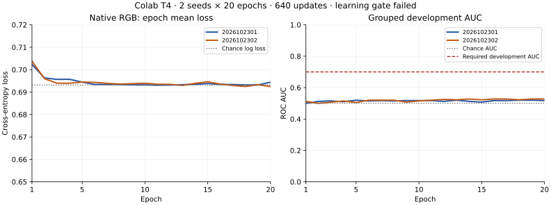

# Native RGB SRNet: completed Colab fitting — 2026-11-07

Execution: **completed**. Learning result: **failed_learning_gate**.
Both approved seeds finished twenty epochs, **640 native optimizer updates /
5,120 training presentations**. All eight numeric checkpoints and forty epoch
records were retained privately. This is a completed native experiment, with
no qualified detector or deployment.

[Machine-readable result](../benchmarks/png-bmp-colab-native-rgb-fit-results-20261107.json)
records source/environment bindings, complete time/storage accounting and
independent verification. The [external deployment protocol](PNG_BMP_COLAB_EXTERNAL_DEPLOYMENT_20261107.md)
preserves the earlier failed setup and all historical debits.

## Results

| Seed | Updates | Train AUC | Development AUC | First /last epoch loss | Learning rule |
| --- | ---: | ---: | ---: | ---: | --- |
| 2026102301 | 320 | 0.505615 | 0.517500 | 0.702336 /0.694389 | Failed |
| 2026102302 | 320 | 0.514648 | 0.527500 | 0.703803 /0.692473 | Failed |

The fixed rule requires both seeds to reach train AUC ≥.85, development AUC
≥.70 and last-epoch loss ≤.8 times first-epoch loss. Each seed fails all three
conditions. Both training and development ranking stay near chance; the loss
stays near binary chance log loss (.693147). This does not establish useful
standalone detection of the native control signal. The run alone does not
isolate the cause. A later [read-only diagnosis](PNG_BMP_NATIVE_RGB_DIAGNOSIS_20261107.md)
finds weak within-original sensitivity overwhelmed by image-specific score
offsets; it preserves the failed learning result. No tuning, seed selection,
extra epochs or reserved scoring was performed.

The plots use the saved epoch records after independent replay. The development
AUC axis spans 0–1; the required .70 threshold and .50 chance level are shown.
Final train AUC is reported separately in the table.

## Fixed scope and actual environment

The unchanged RGB 256×256 IEEE FP32 SRNet/AdamW recipe uses batch eight, learning
rate 1e-4, payload seed 2026102805 and scattered byte-rounded 40%-plane-0 pairs.
AMP/TF32 stay disabled. Numeric states are saved at epochs 5/10/15/20 per seed.
The measured native command remains source-bound to
`7a45cab6774388e9eb156af90eb4c10c962f522a6a2ad6678853fb88e65d7b94`,
with source packet
`a465948b02d85321f802535143ddccb0a0d781f7bb8f029b8b99427013b951f1`.
The corrected deployment changes only operational transfer/watchdog handling;
all 522 tested application/test/script hashes are unchanged.

Actual runtime: Tesla T4, driver 580.82.07, Python 3.12.13, NumPy 2.0.2,
Pillow 11.3.0, Torch 2.11.0+cu128, CUDA 12.8, cuDNN 91900, Runtime Version
2026.07. The unchanged worker verifies that complete environment before model
creation. The existing software gate remains 4,396 passes /two explicit
Kali-CUDA skips /97.225442% coverage; its skips are separate from this actual
physical CUDA execution.

Only 64 train and twenty development originals are used, across 38/12 disjoint
ancestry components. Their proposal is an explicit access overlay; actual
source roles remain unassigned. The reserved 21 RGB originals /19 components
and thirteen L originals stay closed. There is no original acquisition, cache
regeneration, local GPU execution, new capacity profile or historical retry.
The old cache's unavailable final-memory acceptance is preserved.

Training exposure is 5,120 rows. Initial/final train scoring, initial development
scoring and development scoring every epoch add **2,192 inference rows** across
46 actual scoring passes. The last development score is reused from epoch 20;
the auditor checks 48 stored score/AUC records, including those final references.

## Resource and closure evidence

| Observation | Result |
| --- | ---: |
| Charged native command, including closing reserve | 569.256510 /1,370.702460 s |
| Command closing reserve | 20 s |
| Setup at native launch | 194.268513 s |
| Allocation request to confirmed runtime deletion | 920.654108 s |
| Preserved prior profile/external debit | 1,329.297540 s |
| New outside-command debit, rounded upward | 372 s |
| Additional conservative local evidence allowance | 60 s |
| Complete parent cumulative debit | 2,330.554050 /5,400 s |
| Kernel worker peak RAM, including process creation | 1,525,960,704 bytes |
| Complete native command output | 461,183,415 /499,821,368 bytes |
| Eight private numeric states | 459,326,099 bytes |
| Verified metadata archive | 930,625 bytes /1,329 members |
| Conservative combined output, including copies/reserves | 1,790,263,775 /2,147,483,648 bytes |

The 60-second local allowance is conservative, not the measured numeric replay
duration. The parent debit includes observed setup, transfer, export, deletion
and command closing, retaining the earlier consumed 300-second failed setup.
The inner 2,700-second subledger is not relabelled as the complete current
deployment budget. The old 150-second target remains failed even though this
separately authorized deployment completes.

The worker exits zero, is reaped and records zero resident-observer gaps.
Its kernel CPU time is 459.119762 seconds. The RAM peak describes that exact
worker and inherited process-creation memory; whole-tree RAM is unavailable.
The unchanged fitter does not record an allocator VRAM peak, so that peak and
whole-driver GPU peak remain unavailable. The four-GiB Torch allocator guard
and provider-managed RAM policy stay active. Hard native cgroup RAM/zero-swap
enforcement is not claimed.

All downloads completed before runtime deletion. The ordinary account session
manager then confirmed **No active sessions**. Models, raw notebooks, actual
permissions, source/data packets and screenshots remain private. No remaining
time authorizes another fit or tuning run.

## Independent verification

The original Colab controller verifies the closing inventory, all 640 intent/
commit pairs, forty epoch records, eight numeric states, source/data/environment/
order/debit bindings and independent pairwise AUC calculations.

A second local NumPy-only audit verifies all **1,329 archive members**, every
exported numeric-file hash and the external original intent/closing/profile-fit
anchors. It replays **640 commits, eight states and 48 AUC records** without
Torch or native pixel reads. Its numeric/metric receipt matches the original
VM receipt byte-for-byte. Replay takes 3.607338 seconds. The local interpreter
does not impersonate the Colab environment; original VM environment verification
and portable numeric replay are separate checks.

All six exported code-cell ASTs match the private execution copy; counts are
1–6 with no error output. Colab's presentation-only `# @title` prefixes are
allowed explicitly. Browser reconnects/viewport resizing do not relaunch the
native worker; streamed records and exclusive original ledger anchors verify
one complete fit. The initial failed setup's notebook and errors remain intact.

| Closing binding | SHA-256 |
| --- | --- |
| Native closing receipt | `a8f3be7b1044c538b86f35ace0c539e313ead90a1b250a9b2ddcffcf91a0feb2` |
| Metadata evidence archive | `55c0d9a0bd49898aee08dd6f860ee63dd2acd48f3d2fe4895aa716352bd03920` |

The current slice changes documentation/evidence only; no long software gate
is repeated. All fifteen existing README/cloud-removal checks pass after the
result update. Checkpoint/metric integrity passes while the learning rule fails.
Preserve all outputs, exact seeds, historical source licences/debits, reserved
pixels and unassigned metadata. No production qualification, model installation
or subsequent experiment follows automatically from this completed run.
