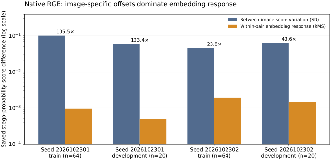

# Native RGB: why the learning gate failed — 2026-11-07

**The measured failure is weak separation of embedding from image-specific
score offsets. Dataset scarcity is a plausible contributor, not an isolated
cause or a demonstrated fix.** The completed experiment stays
`failed_learning_gate`.

This read-only investigation uses all eight existing numeric states, saved
train/development scores and only the 64 previously fitted train originals.
It creates no optimizer, update, GPU allocation or checkpoint. Development
pixels, 21 reserved RGB originals and thirteen L originals remain closed.
[Aggregate evidence](../benchmarks/png-bmp-native-rgb-diagnosis-20261107.json)
binds the original closing receipt and private diagnostic outputs.

The later [eight-checkpoint trajectory](PNG_BMP_NATIVE_CHECKPOINT_TRAJECTORY_20261108.md)
confirms near-chance train ranking at every saved endpoint. The separate
[data/update comparison preparation](PNG_BMP_NATIVE_DATA_UPDATE_STUDY_20261108.md)
fixes nested sources and equal-update contrasts without authorizing execution.

## What the scores reveal

| Seed | Train global AUC | Train correctly ordered pairs | Development global AUC | Development correctly ordered pairs |
| --- | ---: | ---: | ---: | ---: |
| 2026102301 | .505615 | 51/64 | .517500 | 15/20 |
| 2026102302 | .514648 | 61/64 | .527500 | 20/20 |

For many individual originals, the stego version receives a slightly higher
score than its cover. However, the baseline score changes much more between
different originals. On development, the standard deviation of pair midpoints
is **123.42 /43.65 times** the RMS within-pair difference, respectively. A
stego version of one photograph therefore often ranks below a cover version
of another photograph.

The AUC checks every stego against every cover: 400 comparisons for twenty
development originals. Only twenty comparisons share the same original.
The remaining 380 comparisons have AUC **.505263 /.502632**. This explains
how 15/20 or 20/20 correctly ordered matched pairs coexist with the failed
global AUC. Paired ordering needs the known counterpart; it is **not standalone
detection accuracy** or a replacement acceptance metric. These twenty originals
also share twelve ancestry components, so no twenty-independent-image
significance claim is made.

The figure uses only original saved scalar scores. Its vertical axis is
logarithmic; source variation is the population standard deviation of pair
midpoints, and embedding response is the RMS stego-minus-cover difference.
This is an observed failure mechanism; it does not by itself isolate why
training retained those offsets.

## Pipeline and optimizer checks

All 64 train crops match the exact bytes transferred to Colab. Crop hashes
are distinct. Each explicit per-original payload recovery succeeds; only
plane zero changes, by at most one intensity value. Changed samples average
**20.0039%**, consistent with random replacement in approximately 40% of
positions. A 40% payload is not a promise to flip 40% of pixel samples.

The paired FP32 batch is channel-first, labels alternate `[0, 1]`, covers
come first, and raw 0–255 values are preserved. The actual training/scoring
source uses that same ordering. No label reversal, lost embedding or accidental
normalization is evidenced by these checks. This does not exclude every
possible data-quality problem.

Each model has **4,780,768 learned scalar parameters in 105 tensors**. Across
the saved checkpoints, every AdamW parameter step is exactly 80/160/240/320
at epochs 5/10/15/20. Every tensor has a nonzero second-moment history and
changes between epochs 5 and 20, including the first convolution and classifier.
Thus the fit did not leave the model frozen or merely increment a counter.

A separate CPU gradient-only pass on one eight-row train batch per seed finds
all 105 gradients present, finite and nonzero in both models. No optimizer is
created or called; every parameter remains unchanged, and BatchNorm buffers
are restored. These are gradients of the final state on those batches, not
historical gradient norms, which were not logged.

## BatchNorm check

The exact original final states are loaded as validated numeric arrays for
CPU inspection, without invoking environment-bound training restoration.
On all 64 train pairs, ordinary evaluation reproduces the original GPU scores
within **1.79e-7 /3.58e-7** maximum absolute difference and exactly reproduces
both AUCs. The diagnostic uses local Torch 2.14.0+cpu rather than Colab's
2.11.0+cu128; numerical closeness is measured, not assumed.

Keeping weights fixed and using current-batch BatchNorm statistics changes
train AUC to **.512939 /.538330**. The batches use four pairs and the actual
last-epoch order; running buffers are reset before every batch. BatchNorm
affects the result, but that change alone does not recover useful separation
in this check. This is not evidence that BatchNorm has no contribution.
Known paired batches also make this unsuitable as a deployment scoring rule.
The training/evaluation distinction follows the
[PyTorch 2.11 BatchNorm documentation](https://docs.pytorch.org/docs/2.11/generated/torch.nn.BatchNorm2d.html).

## Why the generated pass did not predict this result

The historical positive control explicitly constructs every cover sample as
`random_uint8_0_to_127 * 2`. Every cover low bit is therefore zero. Random
payload replacement introduces approximately 20% one bits in its stego version
(19.9458% in one illustrative generated pair checked here).

Actual train covers instead average **50.2920%** one bits, versus **50.1801%**
for their stego versions. Their per-original cover fractions range from
34.6135% to 63.9587%. The generated recipe therefore permits a large artificial
class cue absent from the native task. Its pass establishes that the software
can learn that generated task, not that it can suppress photographic content.
This investigation does not establish which feature the earlier model used.
The old generated result and its explicit `passed_generated_only` status stay
unchanged.

## What remains causal uncertainty

The pilot has only **64 heterogeneous train originals /38 ancestry components**,
from random initialization, and **320 updates per seed**: twenty epochs times
sixteen batches. Repeated presentations are not new originals. Both limited
data and limited optimization are credible contributors to an inadequate
representation. The current experiment changes neither independently, so their
separate effects cannot be inferred.

For scale, the [original SRNet paper, Section III](https://ws.binghamton.edu/fridrich/Research/SRNet.pdf)
reports 14,000 training cover/stego pairs, Adamax, sixteen pairs per batch and
500,000 updates with a learning-rate schedule. Our RGB adaptation uses AdamW,
four pairs per batch and a fixed 1e-4 rate. Those grayscale experiments involve
different data and embedding methods; their schedule is context, not a required
minimum, a fair matched comparison or evidence that copying it would fix this
pilot. Architecture and optimizer choice remain candidates, not proven faults.

The next discriminating experiment would first test memorization of a fixed
tiny native train subset, then compare dataset size at equal optimizer-update
counts with matched initialization and realistic controls. That would separate
learning failure from generalization failure and avoid confounding more data
with more updates. This is an experimental design only: no new fit, recipe
change, data collection or reserved scoring is executed or authorized here.

## Verification and preservation

The CPU investigation completes in **72.484640 seconds**, with kernel process
RSS peak **2,036,563,968 bytes** and zero optimizer updates. It performs 512
train inference rows across two seeds/two statistics modes, followed by sixteen
gradient-only rows. An eight-GiB DATA-segment limit and 600-second CPU/wall hang
guards apply; a cgroup resident-RAM limit is unavailable and is not claimed.

All eight original checkpoint hashes, the original closing receipt and all
522 frozen application/test/script hashes still match after inspection.
Private evidence is under `.benchmark/png-bmp-native-diagnosis-20261107`;
the public receipt contains aggregate measurements, without host/account paths
or numeric weights. No original source, training output, role or historical
debit is changed. The failed training gate remains failed, and the closed GPU
runtime stays closed.

An [independent stdlib replay](../benchmarks/png-bmp-native-rgb-diagnosis-verification-20261107.json)
verifies 8,992 scalar AUC comparisons, four final score arrays, eight original
checkpoint hashes and all 522 unchanged software bindings, without Torch or
pixel reads. Ruff, 252-file mypy and `git diff --check` pass. This slice changes
documents/evidence only; the unchanged software retains its existing 4,396-pass
/two CUDA-skip gate and 97.225442% coverage. The full suite is not rerun for
these documentation/evidence changes. Preserve the first rejected documentation
patch alongside its corrected publication; it changed no files or experiment.
