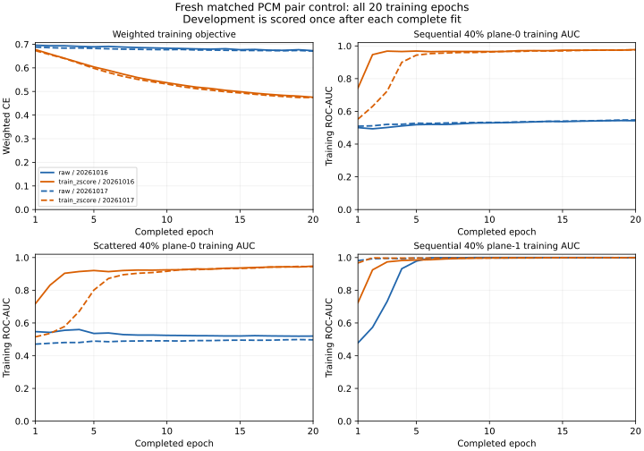

# Fresh matched PCM pair scaling comparison — 2026-10-22

The source-bound experiment compares raw and train-only standardized inputs
on the same fresh generated sources, initializations, minibatch order and full
exposure. Architecture, optimizer and objective are unchanged. This is a new
intervention; earlier failed controls, diagnoses and bindings remain intact.

See the [frozen contract](WAV_PAIR_COMPARISON_PROTOCOL_20261022.md),
[protocol receipt](../benchmarks/wav-pair-comparison-protocol-20261022.json),
[pre-launch binding](../benchmarks/wav-pair-comparison-launch-20261022.json),
[exact coordinator source](../benchmarks/wav-pair-comparison-coordinator-20261022.txt)
and [complete numeric evidence](../benchmarks/wav-pair-comparison-results-20261022.json).

**Raw: failed_learning_gate; train_zscore: passed_generated_only.**

The acceptance rule remains train AUC >=0.60 and both sequential/scattered
40%-plane-0 development AUCs >=0.70, separately in **both** complete seeds of
an arm. Each fit ran 20 epochs /1,140 updates /72,000 presentations: all four
fits total **4,560 updates /288,000 presentations**. There was no early stop,
best-epoch/feature/seed selection, threshold search, checkpoint or retry.

## Full-seed endpoints

| Seed | Arm | Train AUC | Development AUC | Seq 40 p0 development | Scatter 40 p0 development |
|---|---|---:|---:|---:|---:|
| 20261016 | raw | 0.642832 | 0.644666 | 0.543000 | 0.519975 |
| 20261016 | train_zscore | 0.852616 | 0.852638 | 0.984600 | 0.950725 |
| 20261017 | raw | 0.640654 | 0.643388 | 0.550825 | 0.498425 |
| 20261017 | train_zscore | 0.850596 | 0.850988 | 0.979150 | 0.945625 |

AUC measures ranking, **not accuracy**. No native AudioMNIST accuracy or production qualification follows. Both arms share this fresh generator family; the original failed corpus is not a matched reference.

The standardized arm passes while the matched raw arm fails. This supports the scaling intervention within this generated family and these two seeds. It does not isolate every optimization mechanism or establish natural-speech generalization.

## All development cells and matched differences

| Method | Payload | Plane | Raw seed 16 | Z-score seed 16 | Difference | Raw seed 17 | Z-score seed 17 | Difference | Fixed global p0 |
|---|---:|---:|---:|---:|---:|---:|---:|---:|---:|
| sequential | 5% | 0 | 0.517900 | 0.871625 | +0.353725 | 0.520775 | 0.867425 | +0.346650 | 0.556850 |
| sequential | 5% | 1 | 0.732000 | 0.915475 | +0.183475 | 0.723200 | 0.910050 | +0.186850 | 0.513450 |
| sequential | 40% | 0 | 0.543000 | 0.984600 | +0.441600 | 0.550825 | 0.979150 | +0.428325 | 0.743200 |
| sequential | 40% | 1 | 1.000000 | 1.000000 | +0.000000 | 0.998775 | 0.999900 | +0.001125 | 0.537275 |
| scattered | 5% | 0 | 0.503650 | 0.573450 | +0.069800 | 0.498550 | 0.592775 | +0.094225 | 0.525875 |
| scattered | 5% | 1 | 0.536575 | 0.533125 | -0.003450 | 0.538950 | 0.518925 | -0.020025 | 0.507975 |
| scattered | 40% | 0 | 0.519975 | 0.950725 | +0.430750 | 0.498425 | 0.945625 | +0.447200 | 0.696450 |
| scattered | 40% | 1 | 0.804225 | 0.992100 | +0.187875 | 0.817600 | 0.994050 | +0.176450 | 0.531900 |

All train cells and all 20 epoch records remain in the complete JSON. The untrained global-p0 comparator direction/column is unchanged and cannot rescue a failed head. Two seeds and one generated family do not provide a statistical-significance claim.

The scattered 5%-plane-1 cell regresses in both seeds (0.536575→0.533125 and
0.538950→0.518925) and remains near chance. A pass of the frozen 40%-plane-0
control does not establish reliable low-payload or all-method detection.

## Training telemetry

Every complete epoch records all train AUC cells, cover/stego losses, balanced cell CE and full-cache weighted objective, without development scoring or adaptation. Parameters are unchanged by telemetry. The fixed first/final epoch summaries are:

| Seed | Arm | Epoch 1 objective | Epoch 20 objective | Epoch 1 train AUC | Epoch 20 train AUC | Final parameter-change norm |
|---|---|---:|---:|---:|---:|---:|
| 20261016 | raw | 0.695734 | 0.672731 | 0.474339 | 0.642832 | 1.281134 |
| 20261016 | train_zscore | 0.677406 | 0.475565 | 0.611308 | 0.852616 | 3.374410 |
| 20261017 | raw | 0.688041 | 0.671032 | 0.624568 | 0.640654 | 1.013299 |
| 20261017 | train_zscore | 0.672797 | 0.474351 | 0.630751 | 0.850596 | 3.295613 |

Actual pre-step gradient and post-step parameter-change norms, with no extra backward pass:

| Seed | Arm | Update | Objective | Gradient norm | Step norm |
|---|---|---:|---:|---:|---:|
| 20261016 | raw | 1 | 0.818695 | 0.277823 | 0.014933 |
| 20261016 | raw | 57 | 0.537415 | 0.351344 | 0.006694 |
| 20261016 | raw | 570 | 0.900360 | 0.588274 | 0.002002 |
| 20261016 | raw | 1140 | 0.725835 | 0.429050 | 0.002669 |
| 20261016 | train_zscore | 1 | 0.785708 | 0.332579 | 0.020444 |
| 20261016 | train_zscore | 57 | 0.536756 | 0.659725 | 0.008289 |
| 20261016 | train_zscore | 570 | 0.683368 | 0.806834 | 0.006224 |
| 20261016 | train_zscore | 1140 | 0.457898 | 0.940812 | 0.006219 |
| 20261017 | raw | 1 | 0.567691 | 0.630494 | 0.014491 |
| 20261017 | raw | 57 | 0.713944 | 0.095584 | 0.002215 |
| 20261017 | raw | 570 | 1.044940 | 1.354266 | 0.008003 |
| 20261017 | raw | 1140 | 0.755051 | 0.400967 | 0.000818 |
| 20261017 | train_zscore | 1 | 0.564007 | 0.519793 | 0.020444 |
| 20261017 | train_zscore | 57 | 0.648452 | 0.419266 | 0.005505 |
| 20261017 | train_zscore | 570 | 0.863322 | 0.881917 | 0.005464 |
| 20261017 | train_zscore | 1140 | 0.567468 | 1.192355 | 0.004544 |

Only the four preregistered updates are sampled; this is not a complete gradient history. All completed epoch, fit and scored-seed receipts are retained before later fits. Model values and optimizer state are not saved.

## Train-only input transformation

The immutable [normalizer](../benchmarks/wav-pair-comparison-normalization-20261022.json) uses all 3,600 train rows, float64 population mean/std with a 1e-6 std floor; each role is centered/divided in float64 then cast once to FP32. No clipping or development/label/oracle-based estimation occurs. Raw features retain [0,1]; standardized model inputs have their separate finite domain.

| Column | Mean | Stored std |
|---|---:|---:|
| 0 | 0.916663894 | 0.040971520 |
| 1 | 0.819117594 | 0.118284737 |
| 2 | 0.912181678 | 0.069022572 |
| 3 | 0.733070726 | 0.227398109 |
| 4 | 0.821642889 | 0.068880166 |
| 5 | 0.813808014 | 0.071994007 |
| 6 | 0.821644240 | 0.069236728 |
| 7 | 0.814062515 | 0.070738447 |
| 8 | 0.896321926 | 0.072455407 |
| 9 | 0.682510810 | 0.231116821 |

The exact normalizer, raw arrays, manifest and row order are transitively bound by the [fit prerequisite](../benchmarks/wav-pair-comparison-fit-binding-20261022.json). The worker recomputed the train-only state before optimizer construction. Matching seed initialization and permutation digests are identical across arms.

## Data, resources and independent verification

The [fresh manifest](../benchmarks/wav-pair-comparison-manifest-20261022.json)
uses seed 2026102204: 600 generated mono PCM16 files /36,335,714
bytes, 400 train /200 development originals, 20/10 disjoint generated groups.
Raw/PCM hashes are unique and disjoint from both earlier corpora. All **4,800**
independent payload recoveries pass. No original/reserved media were opened.

The profile had zero optimizer updates and unchanged head parameters in both
arms; preprocessing statistics were estimated from train only. Worker profile
time was 23.697788 seconds, with conservative
projection 96.730188 seconds.
Independent systemd phase durations are
24.155810 seconds profile and
5.407780 seconds fit. Profile is charged
as 26 seconds; authoritative combined charged time is
**31.407780 /1,800 seconds**.

Both units enforce 2 GiB /zero swap /200% CPU /no restart, bounded watchdogs
and file limits. Worker-read kernel memory peaks are
278,880,256 /236,437,504
bytes; swap remains zero. Systemd summary memory peaks may be unavailable
after process exit; numeric kernel evidence and independent monotonic phase
timestamps are retained separately.

At closeout, retained experiment output is 1,283,328
bytes and the conservative peak bound, including the entire generated corpus
plus a 3-MiB finalization reserve, is
**40,764,770 /67,108,864 bytes**.
Generated temporary WAVs were removed normally. No historical dataset or
checkpoint was deleted; no raw-transfer ledger or JPEG budget was reset.

All 42 source bindings, normalization/cache hashes, matched initialization /
order and complete telemetry are checked. Every saved score file is bounded,
pickle-free float64, has its expected shape and finite [0,1] values. Independent
all-pairs half-tie replay verifies **72 AUCs**
across four fits, two splits and all cells/overall metrics. Epoch sidecars and
final train/last-epoch metrics agree exactly.

## Software gate and next scope

Full unchanged QA passes **3662 tests /2 explicit CUDA skips**,
96.99102% total coverage. The 64 new focused checks
cover independent scalar normalization/weighted gradients, the full schedule
without real optimizer updates, source/cache/split/state corruption, zero-update
proof and retained first-arm evidence on later failure. New service/adapter
coverage is 98.68421% /
96.55172%.
Ruff and provisioned-environment mypy (223 source files) pass. The first
focused coverage attempt failed during NumPy discovery with dotted module
sources; its log is preserved as unavailable. Namespace-package discovery
works without a source/recipe change or skipped tests. Python 3.11 was run
locally; 3.12–3.14 remain CI requirements. Verification scratch is reported
separately from experimental output and historical ledgers.

Any generated pass applies to this pair-feature head, **not the old raw CNN**.
It does not validate the old CNN-bound native pilot protocol or establish
natural-speech accuracy. The histogram representation remains lossy, and
generated group names are not speaker/recording ancestry. A native comparison
needs its own source/data/domain/exposure/grouping and preprocessing contract,
plus explicit approval; no real fit or production deployment follows here.
Another generated intervention likewise needs a new frozen contract. No
automatic retry or result-selected tuning is allowed.
