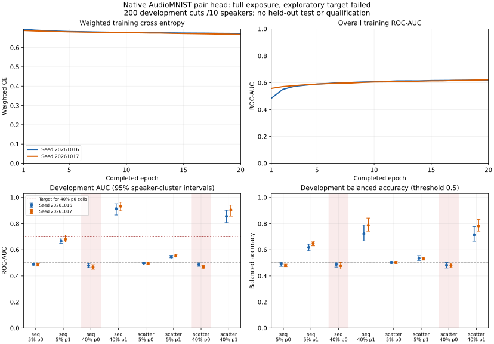

# Native AudioMNIST standardized pair-head results — 2026-10-23

**Completed; failed the frozen exploratory learning target.** The user's
`baslat reis` reply explicitly approved this one two-seed CPU fit after native
preparation. Both seeds completed **20 epochs /1,140 actual optimizer updates
/72,000 row presentations**: **2,280 updates /144,000 presentations** total.
Every complete seed, all 40 train epochs, eight actual gradient/step records
and final score arrays are retained. No automatic retry or further fit occurred.

The [native protocol](WAV_PAIR_NATIVE_PROTOCOL_20261022.md), 49-file source
closure, native cache and train-only normalization remain unchanged.
The [approval](../benchmarks/wav-pair-native-approval-20261023.json) and
[fit launch](../benchmarks/wav-pair-native-fit-launch-20261023.json) bind the
exact protocol, successful profile, previous software gate and 24-second debit.
The earlier preparation/readiness snapshots remain historical and immutable;
their pending-approval state predates this explicit approval and completed fit.

## Learning outcome and full exposure

Each seed exceeds the train-AUC floor .60, but both required 40%-plane-0
cells miss the development target .70:

| Seed | Sequential 40% p0 AUC | Scattered 40% p0 AUC | Required per cell |
| --- | ---: | ---: | ---: |
| 20261016 | 0.478800 | 0.486625 | >=0.70 |
| 20261017 | 0.466650 | 0.468700 | >=0.70 |

The all-cell pooled development AUCs are **0.616641 /0.622978**; these are
ranking statistics, not 61–62% accuracy. The higher plane-1 cells do not rescue
the failed plane-0 rule. At the fixed .5 threshold, cover false-positive rates
are **55% /42%**. The 40%-p1 AUCs range .856100–.932825, while their balanced
accuracy ranges 71.50–78.75%; neither a favorable cell nor lower ECE establishes
usable detection. Low-payload and plane-0 failures are retained below.
The generated control's success did not establish native plane-0 performance.

| Seed | Train pooled AUC | Development pooled AUC | Epoch 1 weighted CE | Epoch 20 weighted CE | Parameter change L2 |
| --- | ---: | ---: | ---: | ---: | ---: |
| 20261016 | 0.618971484 | 0.616640625 | 0.695213022 | 0.672735927 | 1.259105359 |
| 20261017 | 0.621728906 | 0.622978125 | 0.688416938 | 0.667689783 | 1.284900257 |

The plot uses all 20 actual train epochs. Development was scored after each
complete seed, with no early stopping, threshold/direction search, calibration,
OOF refitting or model/seed selection. The two highlighted 40%-p0 cells alone
have the .70 development acceptance target; the other cells remain descriptive.
Both fits start from the fixed random initialization, not transferred weights.
The 418-parameter ten-feature head is not a raw-audio CNN. No CNN was retried.

## All development cells

Every cell has 200 matched cover/stego pairs from ten speakers, threshold .5.
AUC and balanced accuracy show percentile 95% intervals from **2,000 whole-
speaker bootstrap draws**. Each speaker's 20 cuts and paired descendants share
its draw count. The JSON retains every metric interval and paired-difference
interval against the unchanged global-p0 comparator; the table lists every
seed/cell without selecting the favorable ones.

| Seed | Method | Payload | Plane | ROC-AUC [95% CI] | Balanced accuracy [95% CI, %] | Recall | False-positive rate | ECE |
| --- | --- | ---: | ---: | --- | --- | ---: | ---: | ---: |
| 20261016 | sequential | 5% | 0 | 0.489775 [0.481749, 0.497726] | 49.25% [47.25, 50.50] | 53.50% | 55.00% | 0.069476 |
| 20261016 | sequential | 5% | 1 | 0.665875 [0.648049, 0.689828] | 61.75% [59.24, 64.25] | 78.50% | 55.00% | 0.050284 |
| 20261016 | sequential | 40% | 0 | 0.478800 [0.463599, 0.495131] | 48.75% [46.75, 50.50] | 52.50% | 55.00% | 0.074347 |
| 20261016 | sequential | 40% | 1 | 0.913250 [0.866274, 0.952238] | 72.25% [66.75, 79.00] | 99.50% | 55.00% | 0.245431 |
| 20261016 | scattered | 5% | 0 | 0.497850 [0.494149, 0.501375] | 50.25% [49.50, 51.00] | 55.50% | 55.00% | 0.059222 |
| 20261016 | scattered | 5% | 1 | 0.544850 [0.538074, 0.556451] | 53.50% [51.75, 55.50] | 62.00% | 55.00% | 0.028122 |
| 20261016 | scattered | 40% | 0 | 0.486625 [0.473224, 0.499827] | 48.25% [46.00, 50.25] | 51.50% | 55.00% | 0.078618 |
| 20261016 | scattered | 40% | 1 | 0.856100 [0.807296, 0.902753] | 71.50% [66.50, 77.75] | 98.00% | 55.00% | 0.183973 |
| 20261017 | sequential | 5% | 0 | 0.483575 [0.474649, 0.493927] | 48.00% [47.00, 49.00] | 38.00% | 42.00% | 0.082903 |
| 20261017 | sequential | 5% | 1 | 0.679675 [0.658749, 0.712534] | 64.75% [62.99, 66.50] | 71.50% | 42.00% | 0.080864 |
| 20261017 | sequential | 40% | 0 | 0.466650 [0.450723, 0.485501] | 47.75% [45.25, 50.25] | 37.50% | 42.00% | 0.085652 |
| 20261017 | sequential | 40% | 1 | 0.932825 [0.898096, 0.963584] | 78.75% [74.25, 84.25] | 99.50% | 42.00% | 0.252515 |
| 20261017 | scattered | 5% | 0 | 0.496100 [0.489949, 0.500375] | 50.25% [49.50, 51.00] | 42.50% | 42.00% | 0.060276 |
| 20261017 | scattered | 5% | 1 | 0.552000 [0.543949, 0.564450] | 53.00% [52.00, 54.00] | 48.00% | 42.00% | 0.031816 |
| 20261017 | scattered | 40% | 0 | 0.468700 [0.455274, 0.479176] | 48.00% [46.25, 49.75] | 38.00% | 42.00% | 0.082268 |
| 20261017 | scattered | 40% | 1 | 0.904300 [0.857096, 0.941503] | 78.25% [74.25, 83.25] | 98.50% | 42.00% | 0.204889 |

The untrained global-p0 comparator is identical across seeds; its eight AUCs
are .510025, .503025, .5262125, .506100, .5032625, .501875, .525175 and .508550
in the table's recipe order. At threshold .5 its recall/FPR are both 100%,
balanced accuracy 50%, and ECE approximately .48. It is a raw statistic, not a
calibrated probability; its ECE is only a score diagnostic. All exact comparator
metrics and paired intervals are retained in the result JSON.

## Data, validation and resource evidence

Reuse **600 cached AudioMNIST source files**, commit
`630d7dab4c040882834de6fa21baf9a60372accd`: 400 train cuts /20 speakers,
200 development cuts /10 speakers, with the original speaker roles. The
previous recorded MIT license/consent evidence is unchanged. The 30 reserved
speakers remain closed. Parent-recording ancestry is unknown; cuts are grouped
by speaker, not counted as independent recordings. Covers are not certified
clean and this reused development source is not a fresh external test set.
The preparation's 600 raw/PCM hash checks and 4,800 payload recoveries remain
bound; fitting reads their feature caches and does not reopen native media.

All raw, normalization, row-order, score, epoch and source hashes replay.
Independent all-pairs AUC checks match the rank-based scorer for **36** saved
train/development metrics. A separate whole-speaker aggregate implementation
also matches **80 point metrics, 80 cluster intervals, 80 fixed-comparator
metrics and 80 paired-delta intervals**. This audit reads existing arrays and
metadata only and performs **zero optimizer updates**. All 14 historical
numeric-model digests and previous source closures remain unchanged.

Independent fit-unit duration is **6.059356 s**.
With the conservative 24-second profile debit, the charged combined duration
is **30.059356 /1,800 s**. The two
actual unit durations sum to 29.043303 s;
unused time is not another fit allowance. Saved systemd evidence confirms
MemoryMax=2 GiB, MemorySwapMax=0, CPUQuota=200%, Restart=no, bounded runtime,
normal exit and MainPID=0. The fit's cgroup peak was
**260,812,800 bytes**, with zero swap. The native
preparation peak was 283,750,400 bytes, also within its cap.

The complete owned attempt has **559,877 file bytes** at report assembly;
conservative experiment storage, public artifacts and closeout reserve total
**2,888,086 /67,108,864 bytes**. The private verification workspace, including
this small attempt, allocates **6,960,730,112 bytes** at measurement. Verification
scratch is disclosed separately; no dataset or checkpoint was deleted. Raw
transfer is zero and the incomplete historical ledger is unchanged. JPEG time
and storage allowances were unchanged. The fit service is stopped.

The unchanged pre-launch source-bound full gate passed **3,729 tests /two CUDA
skips, 97.00455% coverage**; new service/adapter coverage was
98.31933% /96.77419%. Ruff and 225-file provisioned mypy passed. Python
3.12–3.14 remain CI requirements; actual fitting used the frozen Python 3.11
CPU environment. Post-result documentation/integrity checks are recorded in
[final verification](../benchmarks/wav-pair-native-fit-verification-20261023.json).
No application/training code changed or optimizer update was added for reporting.

No weights, optimizer state or checkpoint were retained, and no detector was
qualified or deployed. Preserve this complete failed target alongside the
accepted generated control and all older failures. This one approved fit is
consumed. Any further fitting needs a distinct frozen intervention and approval;
remaining seconds, a favorable cell or a generated pass grant no automatic retry.

Evidence: [numeric results](../benchmarks/wav-pair-native-results-20261023.json),
[independent replay](../benchmarks/wav-pair-native-replay-20261023.json) and its
[exact audit source](../benchmarks/wav-pair-native-replay-audit-20261023.txt).
